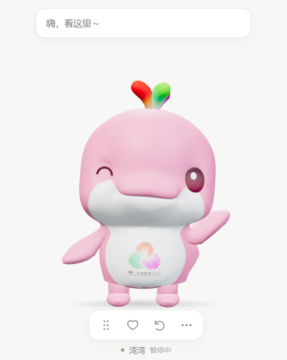
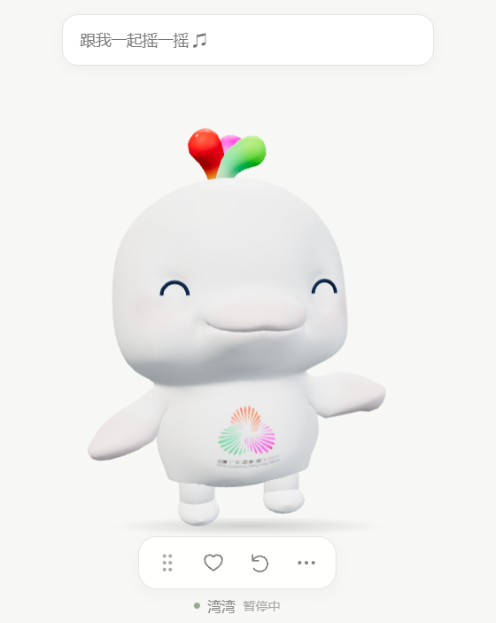
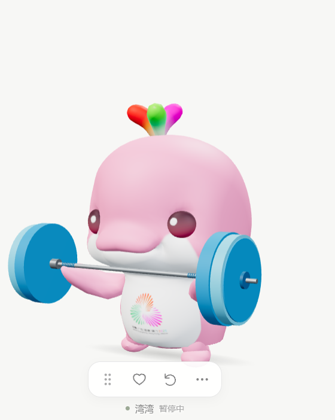
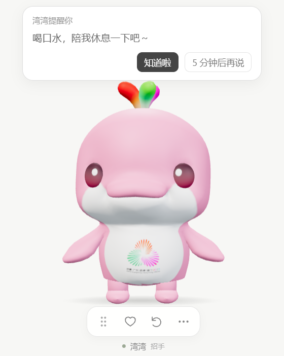

# 湾湾 · 大湾鸡三维桌宠 Beta 🐔

一只可以放在 Windows 桌面上、摸摸头、转着看、陪你整活的大湾鸡。白色与粉色可选，也能给它起自己的名字。非官方个人作品。

**[下载 Beta EXE](https://github.com/MikeJack302/bay-chicken-desktop/releases/tag/v0.8.0-beta.1)** · [下载稳定版 v0.7.0](https://github.com/MikeJack302/bay-chicken-desktop/releases/tag/v0.7.0) · [使用与构建说明](docs/BETA.md)

## 这版可以玩什么

- **三维互动**：左键搬家，右键旋转，滚轮缩放。轻点脑袋、眼睛、肚子和脚丫，会有不同的小反应。
- **新动作与表情**：举杠铃、弓步、弹簧连跳，加上招手眨眼、开心笑眼、发力专注和睡觉闭眼。腿脚重建为有厚度的连续三维网格。
- **日常小玩具**：找凳子坐、吃糖葫芦、玩球、吹风车、打网球、趴在屏幕边缘陪你。
- **轻提醒**：喝水、起身活动、放松眼睛和自定义提醒。每项间隔 1–240 分钟，可试播、暂停和延后 5 分钟。

## 开始体验

下载 `BayChicken-Beta-0.8.0-beta.1-x64.exe` 后双击运行，无需安装 Node.js；动作和提醒不需要 API Key。点 **… → 设置 → 轻提醒**，选择内容与间隔，点 **保存提醒**。

提醒默认关闭，仅在桌宠运行时工作。隐藏、暂停和互动繁忙时顺延；重启或电脑唤醒后重新计时。Beta 使用独立配置，不覆盖稳定版或之前的试验版；首次只继承名字、配色与大小。使用托盘显示/隐藏或退出。

当前是 `0.8.0-beta.1` 预发布版本。Oi、蹲姿等部分动作仍在试作，欢迎通过 Issues 反馈体验。原始头、躯干、胸前图案及整体比例保留。

[完整使用说明与本地构建](docs/BETA.md) · [版本记录](CHANGELOG.md) · [对应的小红书文案与截图](docs/beta-0.8.0/小红书文案.md) · [模型来源](assets/models/SOURCE.md) · [第三方说明](NOTICE.md)
