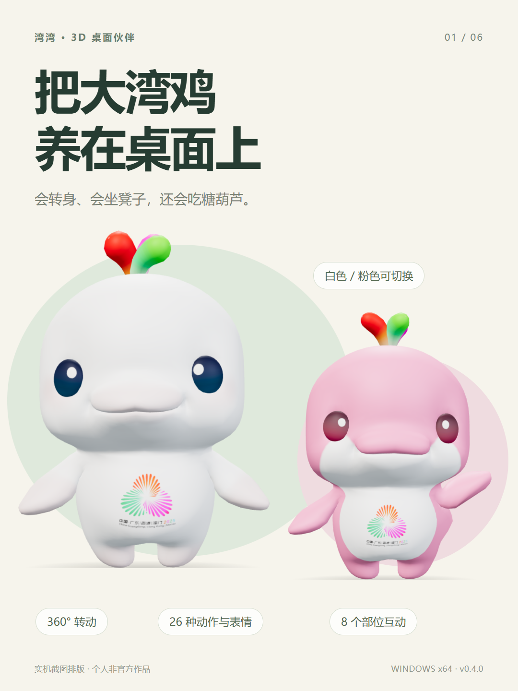
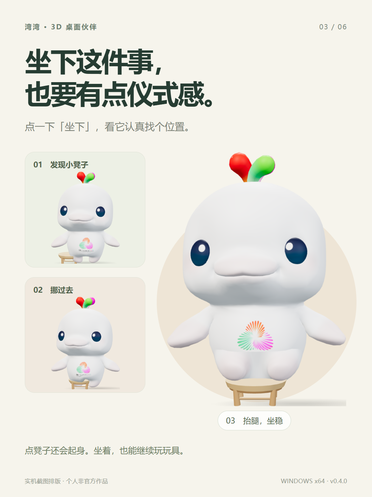
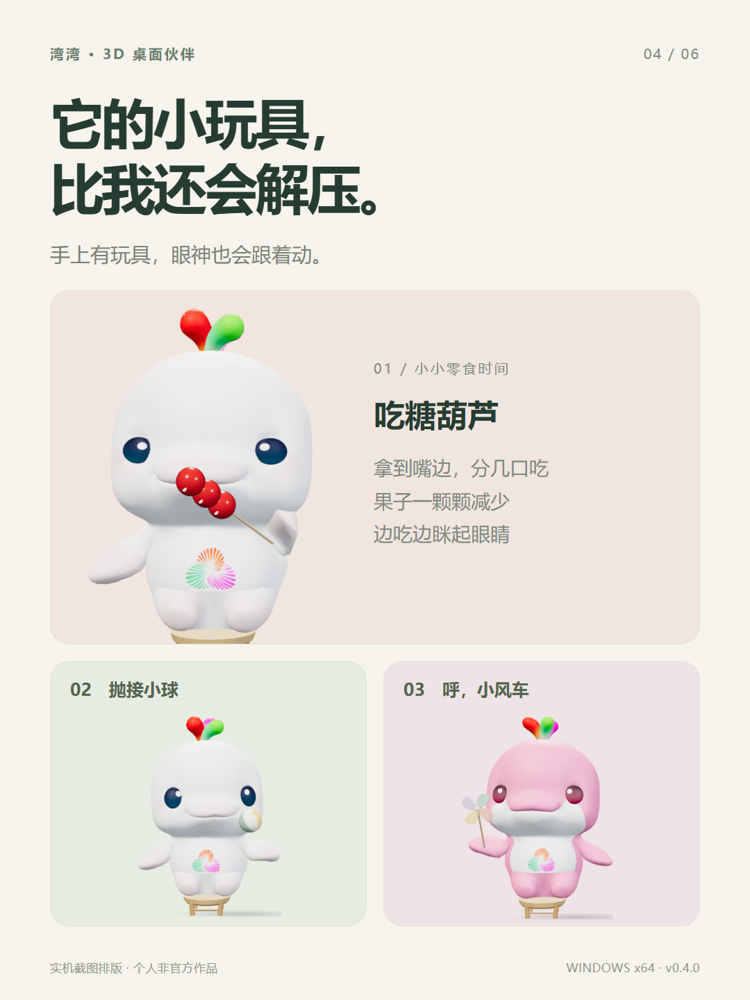

# 湾湾 · 大湾鸡三维桌宠

Windows 透明置顶桌宠原型。使用 Electron + Three.js，保留公开源文件包中的“喜洋洋 / 乐融融”GLB 模型与贴图，在加载时附加 11 根控制骨骼。白色与粉色都支持身体、手臂、短腿、尾巴、眼睛的独立动作。此项目不是官方产品。模型出处见 `assets/models/SOURCE.md`，调研与三视图依据见 `research/model-notes.md`。

**[下载 Windows EXE](https://github.com/MikeJack302/bay-chicken-desktop/releases/latest)** · [小红书文案与配图](docs/share/小红书文案.md) · [来源与第三方说明](NOTICE.md)

<p></p>

## 直接使用

在 Releases 下载适合自己的 Windows x64 版本：

- `BayChicken-Setup-0.4.0-x64.exe`：带中文安装向导，可选择目录，创建桌面和开始菜单快捷方式。卸载时保留用户数据。
- `BayChicken-Portable-0.4.0-x64.exe`：单文件便携版，双击解包并运行；首次启动需要一些解包时间。设置和聊天数据仍保存在 Windows 用户目录，便携版不表示数据随 EXE 移动。

两种 EXE 都已内置模型，形象互动不需要 API Key，不需要额外安装 Node.js。程序未做代码签名。

双击本目录的 `启动湾湾.vbs`，或运行 `release/BayChicken/electron.exe`。免安装版需要保留整个 `BayChicken` 文件夹，可整体移动到其他 Windows x64 电脑；首次启动无需联网下载模型或依赖。

- 拖动玩偶：水平 360° 旋转，垂直拖动查看俯视与仰视；滚轮缩放。双击、按 R 或点回正按钮：回到正面默认视角。Shift + 滚轮也可水平旋转。透视相机显示真正的 GLB 网格，无图片翻转替代。
- 搬家：拖动工具栏最左侧的六点手柄，或按住 Shift / 鼠标中键拖动玩偶。普通拖动只转动视角，不移动桌面窗口。
- 点击脑袋、头顶水花、眼睛、肚皮、小手、脚丫、尾巴或后背：从相应动作组中随机选择，避免同一部位连续触发相同动作。例如摸头或点头、肚子挠痒或开心、脚丫跳跃或单脚站，小手可能招手或玩玩具。睡着时摸头会醒来。短按右键或点三点按钮：打开小型互动浮层；再点三点按钮收起。
- 启动只显示桌宠；工具栏平时淡出，靠近后显示。互动浮层约 280×390，黑白灰样式，常用动作九宫格、更多动作折叠；聊天与设置按需展开为独立页。
- 底栏跟随当前三维模型与道具的屏幕位置，保持约 8 像素间距，并在窗口边缘收紧。缩放、旋转、切换姿势和窗口尺寸变化时重新计算；画布同时更新大小和 DPI，避免宠物与底栏相距很远。
- 共 26 种姿态、动作与表情：站立、坐下、招手、跳跃、跳舞、伸懒腰、转圈、摸头、挠痒、休息、开心、好奇、眨眼、张望、踏步、点头、摇头、鞠躬、单脚站、探头、打哈欠、放松、连跳、吃糖葫芦、抛接小球、吹风车。
- 点“坐下”后，湾湾会发现旁边的小木凳，挪过去、抬腿坐稳；点凳子会起身。三点按钮 → “动作与玩具”中可选择糖葫芦、小球、风车。糖葫芦拿到嘴边分几口吃，果子逐颗减少；小球弹起时目光跟随，风车在手中转动。道具也是三维网格，随视角旋转。玩玩具后保留凳子和坐姿；跳舞、跳跃等动作会站起来。
- 自主动作从十余种行为中选择，避免连续重复；无人互动较久时也会换站姿 / 坐姿。呼吸、重心转移、尾巴、眨眼、视线扫视相互错开，眼睛先追踪，头部随后跟上。支持动作之间平滑混合，跳跃有蓄力与落地回弹，脚底随姿态保持支撑。自主动作与目光跟随可以分别关闭，也可暂停全部动作；暂停时仍可旋转查看模型。
- 设置可调整动作速度、幅度、大小、白色 / 粉色和置顶。设置会保存在本机，升级时保留原有配置。
- F8：显示 / 隐藏。Ctrl + Alt + B：互动面板。画布有焦点时，1–6 为站立、坐下、跳舞、跳跃、招手、休息；空格摸头；R / Esc 回正视角。快捷键被占用时可用托盘。
- 小窝右上角的关闭按钮仅收起面板；从设置或托盘菜单退出整个程序。“说说话”中保留上一版的聊天功能。

动作属于在原始模型上新增的轻量程序骨骼与平滑姿态过渡，不是素材自带的动作捕捉。原始 GLB 二进制与 UV 不变。

## 接入真正的 AI 聊天

未配置时是**离线预设回应**，用于体验交互，不是离线大模型。进入“小窝设置”：

1. 选 OpenAI，地址为 `https://api.openai.com/v1`，填写自己账号可用的模型名称和 API Key，保存。默认模型为官方文档示例的 `gpt-6-astra`，可按账号权限修改。
2. 其他服务选“兼容接口”，填写该服务的 `/v1` 基地址、模型名与对应密钥；使用 Chat Completions 流式接口。
3. 本机 Ollama 等服务可填 `http://localhost:11434/v1`，模型名必须对应已经安装的模型，本机无鉴权服务可不填密钥。应用不会安装或启动本机模型。

API Key 仅主进程持有，通过 Electron safeStorage 的 Windows 系统加密保存，不传给渲染页面。切换到不同服务域名会清除旧密钥，需要填写新服务密钥。不会读取 Codex 的登录凭据或自动接管当前聊天。AI 模式需要可用模型服务；本桌宠的对话是独立会话。

接入模型后，每次发送当前问题和最近 24 条对话给所选服务；OpenAI 请求设 `store:false`。聊天历史最多保留 80 条，在本机 `%APPDATA%/bay-chicken/companion.json` 保存，可点“清空聊天”删除。聊天历史是明文，密钥是系统加密密文。卸载便携文件夹不会自动删除这个用户数据目录。

支持流式回复、停止生成、90 秒超时、错误提示和本地聊天记录。语音功能是 Windows 已安装语音的文字朗读；本版以文字聊天为主，没有麦克风语音输入。无需提供密钥也能使用桌宠互动。连接状态“已配置”表示配置就绪，首次实际发送才验证服务可用性。

## 开发

Node.js 22+、pnpm 或 npm：

```powershell
pnpm install
# 若包管理器禁止安装脚本，执行：node node_modules/electron/install.js
pnpm start
pnpm test
pnpm run pack
pnpm run exe
```

文件夹便携产物输出到 `release/BayChicken`，EXE 安装版与单文件便携版输出到 `release/exe`。打包配置见 `electron-builder.yml`；运行时、NSIS 和压缩工具首次打包时可能需要联网下载。

分享素材可用 `pnpm run share:capture` 从应用采集，再用 `pnpm run share:render` 生成 6 张 1080×1440 配图。排版脚本默认使用本机 Edge 的无头模式，可通过 `BAY_BROWSER_CHANNEL=chrome` 改用已安装的 Chrome。原始截图在 `docs/share/raw`，输出图片和文案在 `docs/share`。仅截图采集使用隔离数据目录，不会读取个人聊天或密钥。

代码入口：`src/pet.js` 桌宠交互与透视渲染；`src/layout.mjs` 模型投影与底栏停靠；`src/interactions.mjs` 部位识别与随机反应；`src/props.js` 三维凳子、糖葫芦、小球与风车；`src/orbit.mjs` 双轴环绕、惯性、缩放与回正；`src/character.js` 骨骼权重、独立眼球、脚底支撑与姿态插值；`src/motion.mjs` 动作状态机、过渡混合、分层小动作、眨眼与目光；`src/panel.js` 浮层与设置；`electron/main.cjs` 窗口、托盘和持久化。

桌面端端到端验证：安装 Playwright 后运行 `node scripts/smoke.cjs` 和 `node scripts/props-smoke.cjs`。也可设置 `BAY_PLAYWRIGHT` 为现有 Playwright 包的绝对路径。设置 `BAY_EXECUTABLE` 可验证便携产物。测试使用隔离用户目录，检查原始模型贴图、骨骼、站坐与各动作、两色眼球和眨眼、指针跟随、身体部位随机点击、暂停与行为开关、画布原生尺寸变化、底栏距离、道具按钮及收放，并导出截图到 `test-results/`。原有聊天回归测试仅请求本机模拟服务，不请求真实模型或花费 API 额度。`pnpm test` 另检查姿态有限性、自动动作关闭、暂停、坐姿恢复、部位随机选择和底栏边界。

接口依据：[OpenAI Docs 文本生成](https://developers.openai.com/api/docs/guides/text)。窗口交互：[Electron 文档](https://www.electronjs.org/docs/latest/tutorial/custom-window-interactions)。密钥存储：[safeStorage](https://www.electronjs.org/docs/latest/api/safe-storage)。
